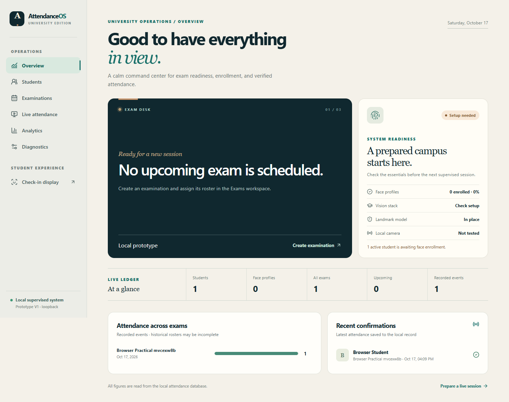
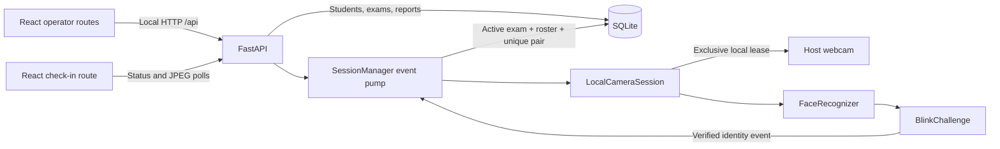
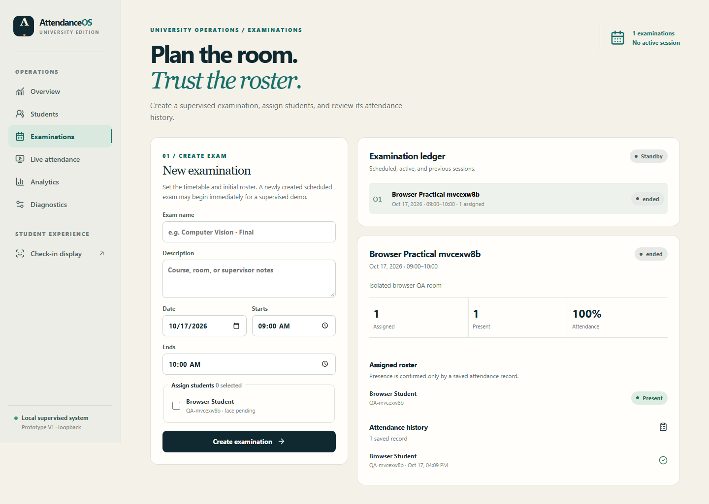

# AttendanceOS

### A local, supervised examination attendance prototype

AttendanceOS pairs a React operator dashboard and student check-in display with a FastAPI service, a host-owned camera, face matching, an eye-blink challenge, and SQLite records. It is designed for a supervised Windows demonstration. The browser reads status and camera frames from the local API; only the API can save an attendance event.



## What the prototype does

- **Operator workspace:** Overview, Students, Examinations, Live attendance, Analytics, and Diagnostics at `/`, `/students`, `/exams`, `/attendance`, `/analytics`, and `/diagnostics`.
- **Student display:** `/check-in` shows the current check-in state without roster or administration controls.
- **Enrollment:** register a student, then upload one JPG, PNG, or BMP image containing exactly one face. The service stores a local photo and 128-value face template, and rejects a reused image or a close match to another enrolled identity.
- **Examinations:** create an exam with a dated timetable and participant roster, edit a scheduled roster, start one active exam, then end it. Attendance is scoped to that exam.
- **Live verification:** an identity-bound blink challenge feeds a background event pump. The API checks the active exam and roster before inserting a record.
- **Reporting:** examine saved records, known-roster assigned/present/absent counts, attendance rates, and a CSV export. Historical exams with unknown rosters retain their records but have no inferred denominator.
- **Diagnostics:** inspect SQLite, native CV availability, landmark model, camera ownership, and a release-after-probe camera check.

## Technology

| Layer | Source and dependencies |
| --- | --- |
| Web | React 19, TypeScript, Vite 7, React Router 7, Framer Motion, Lucide React |
| API | Python, FastAPI, Uvicorn, Pydantic (via FastAPI) |
| Vision | OpenCV, `face-recognition`, dlib, NumPy; 68-point landmark predictor supplied locally |
| Data | SQLite through Python's `sqlite3`; local face photos and embedding blobs |
| Checks | Python `unittest`, pytest, HTTPX and HTTPX2 for development, TypeScript compiler, Vite build, Playwright browser scripts |

The Python constraints are in [`attendance_pro/requirements.txt`](attendance_pro/requirements.txt), development additions in [`requirements-dev.txt`](attendance_pro/requirements-dev.txt), and JavaScript dependencies in [`package.json`](attendance_pro/frontend/package.json).

## System architecture



The FastAPI process owns the camera. A local advisory lock prevents another AttendanceOS process or diagnostics probe from taking the same camera index. Starting the camera binds the worker to the **current exam ID**; a later exam change cannot reassign a pending event. A background pump consumes verified events independently of browser polling, so a browser refresh does not determine whether an event is saved. Pause, exam end, API shutdown, startup failure, and worker failure release the capture and lease. The browser may show success only after the API reports a saved outcome. See [architecture details](attendance_pro/ARCHITECTURE.md).

## Recognition and eye-blink pipeline

1. **Enroll:** decode an image of at most 12 MB and 12 megapixels; require exactly one detected face and one encoding. Compare the new template against other enrolled identities and reject an identical image digest or a match within the configured tolerance. Save the photo under a hashed student folder and the 128-value encoding in SQLite.
2. **Capture:** OpenCV reads frames from the host camera. `face_recognition` detects faces using HOG by default. Verification proceeds only when exactly one face is present.
3. **Match:** compare the frame encoding to enrolled templates using Euclidean distance. The closest template is accepted when its distance is at most `FACE_TOLERANCE` (default `0.48`). This number is a configuration threshold, **not** a measured accuracy rate.
4. **Measure eyes:** dlib's local 68-point landmark model locates both eyes. The service averages each eye's Eye Aspect Ratio (EAR), based on vertical eye distances divided by horizontal width.
5. **Challenge:** hold the same recognized identity for three processed frames, then observe EAR below `0.21` for two processed frames followed by reopening. The challenge resets on an unknown, changed, missing, or multiple face, or after a 12-second absence. A verified state produces a queued identity event; it can rearm after the challenge resets.
6. **Persist:** the API serializes an active-exam and active-roster check with the SQLite insert. `UNIQUE(exam_id, student_id)` prevents a second attendance row even after a camera restart or another successful blink. The operator receives recorded, rejected, or error feedback.

Lighting, focus, pose, glasses, occlusion, and lookalikes can affect matching. An ordinary blink is a limited liveness signal and has no anti-spoofing guarantee. Recognition accuracy and false accept/reject rates have **not been measured**. The complete physical-camera path remains to be verified on a compatible Windows computer with a consented participant.

## Repository layout

```text
README.md
docs/screenshots/                 Synthetic UI captures only
attendance_pro/
  api/                            FastAPI endpoints and camera session manager
  attendance/                     SQLite, configuration, migration, CV, liveness, diagnostics
  frontend/
    src/features/                 Seven React routes
    src/components/, layouts/, hooks/, services/, styles/
    scripts/                      Browser checks
    package.json, package-lock.json, vite.config.ts
  tests/                          Python API, database, CV-state and diagnostics tests
  backup_data.py, verify_backup.py
  init_database.py, populate_db.py
  run-local.ps1                   Windows launcher
  requirements.txt, requirements-dev.txt
  .env.example                    Configuration reference; not auto-loaded
```

### API and SQLite

The API is implemented in [`api/main.py`](attendance_pro/api/main.py), with camera lifecycle and event persistence in [`api/session.py`](attendance_pro/api/session.py). Its [API contract](attendance_pro/api/README.md) lists payloads, responses, and errors. Key endpoints include:

| Method and path | Purpose |
| --- | --- |
| `GET /api/health`, `POST /api/diagnostics/camera` | Readiness and an exclusive, released camera probe |
| `GET /api/overview` | Live totals, featured exam and recent saved records |
| `GET/POST /api/students`, `POST /api/students/{id}/enrollment` | Directory, registration and local face enrollment |
| `GET/POST /api/exams`, `GET/PUT /api/exams/{id}/roster` | Exam scheduling and participant assignment |
| `POST /api/exams/{id}/start`, `POST /api/exams/{id}/end` | Exam lifecycle |
| `POST /api/session/camera/start`, `POST /api/session/camera/pause` | Host camera lifecycle |
| `GET /api/session/status`, `GET /api/session/frame` | Current verification state and latest JPEG |
| `GET /api/exams/{id}/attendance`, `GET /api/analytics` | Exam records and filtered reports |

[`attendance/db.py`](attendance_pro/attendance/db.py) creates `students` (ID, name, active flag), `face_enrollments` (student ID, photo path, embedding blob, image hash), `exams` (schedule, status, description, roster-known flag), `exam_participants` (exam/student pair), and `attendance` (exam/student pair, timestamp, method). Foreign keys connect attendance to assigned participants. The exam/student pair is unique in both roster and attendance. Imported legacy exams can have an unknown historical roster; their saved records remain visible without fabricated attendance rates.

## Typical operator workflow

1. Register a student on **Students**, then enroll a consented single-face photo. The student directory indicates enrollment state without returning the photo or embedding to the browser.
2. Create an examination, choose active students for its roster, and review the participant list. A roster can change only while the exam is scheduled.
3. Start the exam, open **Live attendance**, and resume the host camera. Ask one participant at a time to face the camera, hold still, and blink once. The API confirms a saved event or explains a duplicate/roster rejection.
4. Use `/check-in` as a separate local display if desired. Inspect saved results and export CSV from **Analytics**. Pause the camera and end the exam when finished.

The [demonstration guide](attendance_pro/DEMO.md) uses an isolated database and a consented volunteer.

## Windows installation and startup

Use Python **3.11** and Node.js with npm. From the repository root in PowerShell:

```powershell
cd attendance_pro
py -3.11 -m venv .venv-app311
.\.venv-app311\Scripts\python.exe -m pip install -r requirements-dev.txt
.\.venv-app311\Scripts\python.exe -m pip check
cd frontend
npm ci
cd ..
.\run-local.ps1 -Python .\.venv-app311\Scripts\python.exe
```

Open `http://127.0.0.1:5173/`. The launcher starts FastAPI at `127.0.0.1:8000` and Vite at `127.0.0.1:5173`, using the ignored `.demo-data/` directory by default. Press **Ctrl+C** to stop. Its `-Operational` switch selects the local `attendance_system.db` and `known_faces/`; use it only when intentionally operating on those preserved files. The [OpenAPI explorer](http://127.0.0.1:8000/docs) is available while the API runs.

If port 8000 is already occupied, pass `-ApiPort 8011` to the launcher. It sets Vite's API proxy to the selected port. The browser remains on port 5173.

For separate terminals, run the following from `attendance_pro` after installation:

```powershell
# Terminal 1
New-Item -ItemType Directory -Path .demo-data -Force | Out-Null
$env:ATTENDANCE_DB = (Join-Path (Get-Location) '.demo-data\attendance.db')
$env:KNOWN_FACES_DIR = (Join-Path (Get-Location) '.demo-data\known_faces')
.\.venv-app311\Scripts\python.exe -m uvicorn api.main:app --host 127.0.0.1 --port 8000 --no-access-log

# Terminal 2, from attendance_pro/frontend
npm run dev
```

The local Vite server proxies `/api` to the local FastAPI service. Set `LANDMARKS_DAT` to a local **dlib 68-point predictor** file, or place it at `attendance_pro/attendance/landmarks.dat`. That model is needed for blink verification and is deliberately excluded from Git; cleanup does not delete an existing local copy. Native dlib installation on Windows may require a compatible wheel or CMake and Visual Studio C++ Build Tools. Confirm **dlib + NumPy: compatible** and probe the physical camera in Diagnostics before a live demonstration. Other configuration defaults appear in [`.env.example`](attendance_pro/.env.example); export them in the shell because the app does not load that file automatically.

## Verification

From `attendance_pro`, run the full Python suite with `.\.venv-app311\Scripts\python.exe -m unittest discover -s tests -v`. From `attendance_pro/frontend`, run `npm run typecheck` and `npm run build`. With both local servers running against isolated demo data, use `node scripts/visual-qa.mjs`, `node scripts/interaction-qa.mjs`, and `node scripts/state-qa.mjs`. The journey script uses `.qa-api.db` and writes one synthetic attendance row directly for reporting checks; it does **not** demonstrate biometric verification. Its instructions are in the [frontend design notes](attendance_pro/frontend/DESIGN.md).

**Release verification, 17 October 2026:**

| Check | Result |
| --- | --- |
| Python `unittest` discovery | **24 passed** in both the existing Python 3.10 environment and a NumPy 1.26.4 / dlib 19.24.1 Python 3.11 environment: API, SQLite, migration, enrollment guards, face matching, blink state, camera lease and diagnostics mocks |
| `pip check` and `compileall` | `pip check` passed in both environments; `compileall` passed in the available Python 3.10 environment |
| `npm run typecheck` and `npm run build` | Passed; Vite emitted non-fatal dependency `use client` directive warnings |
| Browser route/layout script | **35/35** route and viewport combinations returned HTTP 200 with no page errors or horizontal overflow (7 routes × 5 widths: 1920, 1440, 1024, 768, 390 px) |
| Browser interaction and kiosk state scripts | Passed navigation, API-driven metrics, mobile menu, reduced motion, and intercepted check-in states |
| Browser journey | Passed student registration, duplicate rejection, invalid enrollment feedback, exam/session flow, reporting and CSV in `.qa-api.db`; its one attendance row was inserted directly for reporting verification |
| Windows launcher | Started the isolated API and Vite successfully using `-ApiPort 8011` because port 8000 was occupied by another local process; API health and proxied overview responded |
| Local data backup | Verified **2 SQLite databases and 16 face images** against the ignored local backup; none is part of the release tree |

The available `.venv` uses NumPy 2.2.6 with dlib 19.24.1. Its API health check reports that dlib rejects a normal RGB array; a physical camera could open, but recognition stopped at that native incompatibility. The published requirements pin NumPy 1.26.4 for a fresh environment. Physical-camera recognition and real blink-to-database completion remain **unverified**; no hardware success, recognition accuracy, or performance figure is claimed.



These screenshots show synthetic browser QA content, not students' photos or operational attendance data. The [small-screen overview](docs/screenshots/overview-390.png) illustrates the responsive layout.

## Privacy and security boundaries

The application is a **local prototype**, not production-ready. The API has no operator authentication or encrypted transport. It restricts hosts and browser origins for the local workflow, but those checks are not a substitute for access control. Bind both services to loopback, keep Windows filesystem access limited to authorized operators, obtain consent for enrollment, and define a retention/deletion policy before using real student data. CSV exports contain personally identifiable attendance records and should be handled accordingly.

Operational SQLite databases, face photos, biometric embeddings, local backups, runtime logs, virtual environments, and the landmark predictor are excluded from the published source. The API's student directory does not return photo bytes or embeddings. Use `python backup_data.py` from `attendance_pro` to create a verified ignored local backup and `python verify_backup.py <backup-folder>` to check it. Historical Git commits need a separate owner-led exposure review; repository cleanup does not rewrite history.

## Roadmap

- Verify the complete camera and blink flow on a compatible Windows host with consented participants; document failure cases and latency after measurement.
- Add authenticated operator roles, encrypted deployment transport, audit logs, retention controls, and explicit biometric consent workflows.
- Evaluate recognition and presentation-attack resistance on an approved dataset before considering any unsupervised or wider deployment.
- Add deployment packaging and repeatable native dependency installation once hardware compatibility is established.
