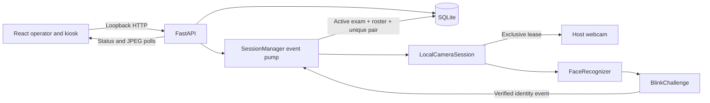

# Architecture and Computer Vision behavior

The frontend polls status and JPEG frames independently. It never writes attendance. The API's background pump consumes verified events even if browsers disconnect or refresh. Each camera run is bound to its starting exam ID; a late event cannot be moved into a newly active exam. `Database.record_attendance` serializes the active check and insert with a write transaction, checks active roster membership, and relies on a unique `(exam_id, student_id)` constraint. Two frontend clients read the same state; they do not create separate camera workers. A local advisory lease coordinates API and diagnostics processes. Camera handles and lease are released on pause, end, startup failure, worker failure, and API shutdown.

## Vision path

1. OpenCV reads host frames. `face_recognition` detects faces with the configured HOG model by default.
2. Exactly one face is required. The 128-value encoding is compared to local enrollment templates by Euclidean distance. The best match is accepted at distance `<= 0.48` by default. Enrollment validates exactly one face and rejects an image digest or encoding too close to another student's profile.
3. dlib's 68-point landmarks provide eye coordinates. The average Eye Aspect Ratio (EAR) uses both eyes. The configured default threshold is `< 0.21` for two processed closed-eye frames, followed by reopening.
4. Identity must remain stable for three processed frames before the blink counts. The challenge resets on a missing, unknown, changed, or multiple face, or after a 12-second absence. A verified identity event is queued once per completed challenge and can rearm after the challenge resets. Database uniqueness protects further attempts and camera restarts.
5. The API writes the result only if that same exam remains active and the student is on its roster. It returns `recorded`, `rejected` (duplicate or unassigned), or `error` feedback to the operator. The kiosk shows recorded success only after the API confirms the insert.

The current model accuracy is **NOT MEASURED**; no consented evaluation dataset or sample size was supplied. The threshold is a configuration value, not an accuracy estimate. Lighting, pose, focus, glasses, occlusion, motion, lookalikes, and camera exposure can cause false acceptance or rejection. Multiple simultaneous faces stop the challenge. Blink checks can be fooled by replay or presentation attacks and must be supervised. The system has no anti-spoofing guarantee or remote student authentication.

## Data and security boundary

SQLite, enrollment images, embeddings, landmark model, demo data, and local backups are Git-ignored. API student responses contain ID, name, active and enrolled flags; no embeddings or photo bytes are returned. Image uploads are streamed with a 12 MB cap and decoded by the existing enrollment service. The API allows local Vite origins, restricts request hosts, and rejects foreign write origins. It must bind to `127.0.0.1`; it has no operator login or transport encryption. Filesystem access and consent are the operator's responsibility. Public network deployment requires a separate security design.

Legacy imported exams have unknown historical rosters. Analytics excludes them from assigned, absent, and percentage aggregates while showing their saved records. A zero-denominator known roster likewise has no percentage.
